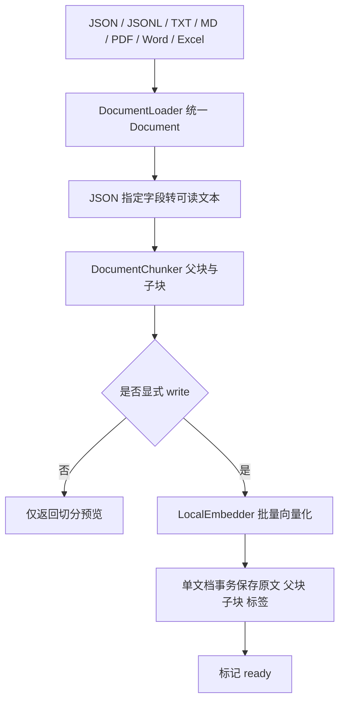
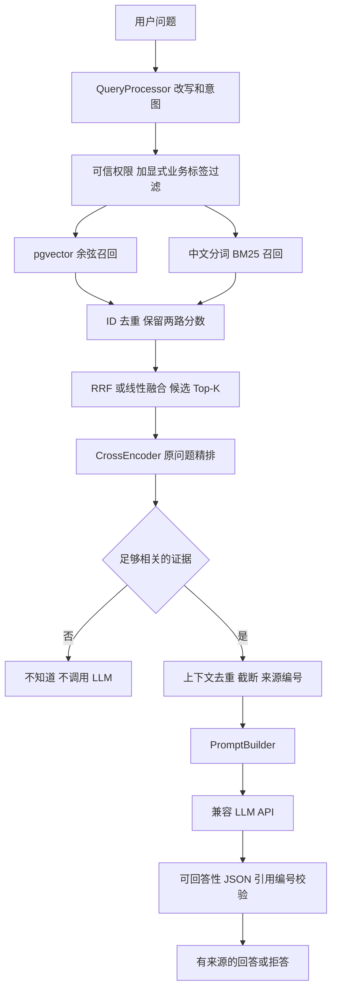

# 核心架构

## 两个主类

`IngestionPipeline.run()` 是第一主流程，`RAGPipeline.ask()` 是第二主流程。从根目录 main_ingest.py 和 main_ask.py 直接启动。主类按顺序调用其他普通对象，不使用 Protocol、dataclass 或框架。对象创建写在 cli.py 的两个普通函数中，逐行展开便于调试。

## 职责表

| 组件 | 输入 → 输出 | 关键约束 |
|---|---|---|
| DocumentLoader | 文件 → Document 列表 | 保留 payload、page / sheet / row 等来源；PDF 空页明确提示 |
| DocumentChunker | 正文 → 父块与子块 | 字符预算、自然边界、overlap、原文偏移 |
| LocalEmbedder | 文本 → 512 维向量 | 文档与问题同模型，归一化、数量与维度检查 |
| PostgresRepository | 统一结构 ↔ 数据库 | 参数化 SQL；问答事务只读；入库原子保存 |
| QueryProcessor | 原问题 → 改写 / 意图 / 实体 | 保留原问题，不推断权限，不自动硬过滤业务模块 |
| BM25Retriever | 查询与授权语料 → 排名 | 复用旧 rank_bm25.BM25Okapi；中文 jieba 分词 |
| ResultFusion | 两路排名 → 唯一候选 | ID 去重；保留双路信息；RRF 或线性缩放融合 |
| CrossEncoderReranker | 原问题 / 候选 → 排名 | query/document 成对打分，显式 Sigmoid |
| ContextBuilder | 精排结果 → 资料与来源 | 先去除完全重复正文再取 Top-K，来源头计入预算 |
| PromptBuilder | 问题 / 资料 → messages | 资料不可信，不执行资料中的指令，证据不足拒答 |
| AnswerValidator | 模型 JSON → 答案 / 引用 | 引用编号必须存在并与正文一致 |

## 数据一致性

- 幂等键是 `(tenant_id, external_id, version)`，同一版本内容不同则报错，不静默覆盖。
- 内容指纹包含 JSON、来源、标签和权限。切分参数与模型构成独立 `pipeline_fingerprint`；参数改变时需新版本。
- 原文、父块、子块、标签关联在一个文档事务内提交，向量失败时不会留下半篇可检索文档。批量导入为逐文档事务，前面成功文档不会因后面失败而撤销。
- 同一业务文档使用事务级 advisory lock 串行发布；部分唯一索引保证最多一个最新版本。版本先后由输入的 `is_latest` 明确表达，不根据字符串版本号推断大小。
- SQL 初始化原文先为 pending，向量全部写完才改为 ready。重复完整导入返回 unchanged；当前实现仍会先计算 Embedding 再检查数据库幂等状态，便于保持流程清晰。
- 业务实体用 `metadata.entity_ids` 精确包含过滤，不用全文模糊 LIKE。多个实体出现在同一问题时不施加单实体条件，避免只召回其中一个。

## 来源及压缩边界

PDF 按页入文档，Excel 按行入文档；Word 提取段落和表格，当前不恢复分页和混合排版顺序。普通 Markdown 不自动推导标题树，可在 JSON metadata 中明确提供 section。父块保留原文关系，当前问答使用子块引用，未实现父块扩展。

上下文压缩是原文去重和字符截断，不是 LLM 摘要。截断后只向用户返回实际发送给 LLM 的 excerpt。字符预算不等于 token 预算，后续换长上下文模型时再加入对应 tokenizer 的精确预算。

未获同意不接触数据库、不删除目录、不执行 Git/SVN。
