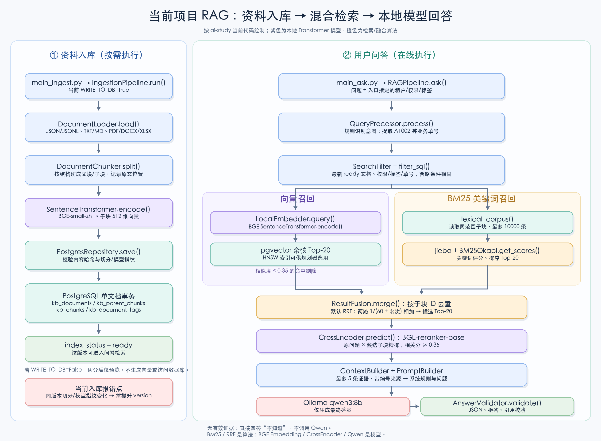
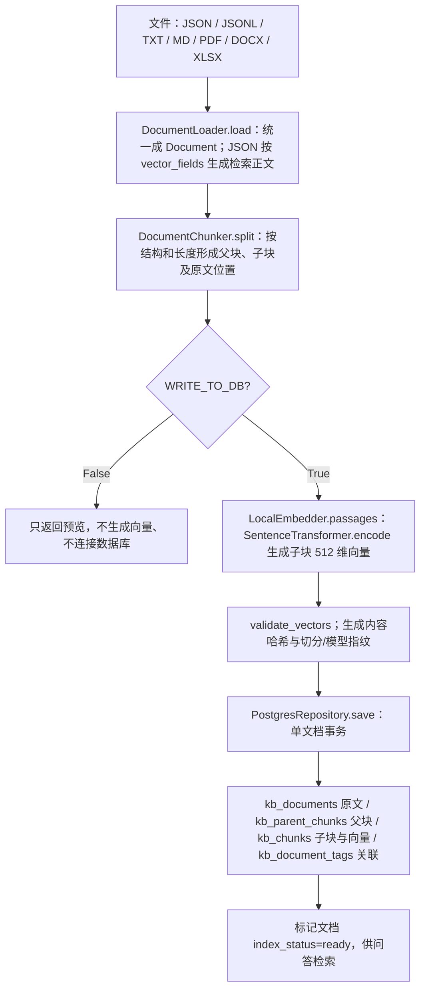
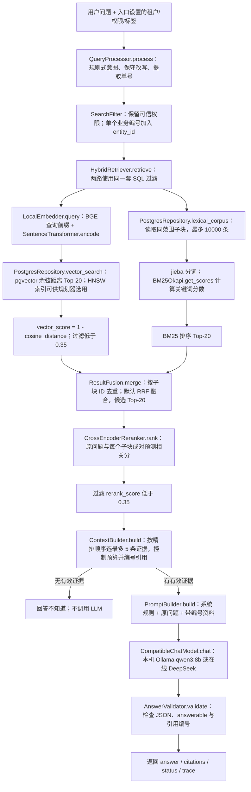

# 核心架构

## 两条主流程

`IngestionPipeline.run()` 是资料入库主流程，`RAGPipeline.ask()` 是问答主流程。从根目录 `main_ingest.py` 和 `main_ask.py` 启动；`cli.py` 中的 `build_ingestion_pipeline()` 和 `build_pipeline()` 只创建组件对象，真正执行发生在 `run()` 和 `ask()`。下面只展示检索、融合、模型调用等关键步骤，省略局部字符串处理。

### 资料入库：`main_ingest.py` → `IngestionPipeline.run()`

`kb_tags` 是已有的标签字典；入库时查询标签是否存在，再写 `kb_document_tags` 关联，不会自动新增标签字典项。同一 `(tenant_id, external_id, version)` 已经是 `ready` 时，内容或切分/模型指纹变化会报错，要求新版本；此次遇到的入库报错发生在这一步。

### 用户问答：`main_ask.py` → `RAGPipeline.ask()`

`QueryProcessor` 目前不是意图模型：它按关键词识别 `refund`、`order`、`policy`、`general`，并识别 `A1002`、`R1001` 这类编号。`intent` 主要放在 `trace` 里供观察，**没有按意图切换检索模型或自动添加业务模块过滤**；只有识别出唯一业务编号时，才补充 `entity_id` 精确过滤。租户、安全级别等权限只能来自入口传入的 `SearchFilter`。

BM25 是 `rank_bm25` 库的经典关键词排序算法，不是 Transformer 模型。当前实现每次查询都读取过滤后的子块，在 Python 中用 `jieba` 分词并创建 `BM25Okapi`；数据库中没有单独的 BM25 索引。向量路使用本地 `BAAI/bge-small-zh-v1.5` 和 PostgreSQL `pgvector`；SQL 中设置 `hnsw.ef_search=100`，表上有 HNSW 余弦索引，但具体是否使用索引由 PostgreSQL 查询规划器决定。`vector_score` 是 `1 - (embedding <=> query_vector)`。

默认融合方式是 **RRF**（倒数排名融合）：一个子块在某一路排第 `rank` 名，就贡献 `1 / (60 + rank)`；两路都命中时贡献相加。它根据**排名**融合，不直接相加余弦分数与 BM25 分数。配置改为 `linear` 时才使用各路分数归一化后的加权和。精排另用本地 `BAAI/bge-reranker-base` CrossEncoder 对 `(原问题, 子块正文)` 成对打分。最后的 `qwen3:8b` 只生成答案，不参与意图识别、Embedding、BM25、RRF 或精排。

## 关键调用位置

| 步骤 | 当前代码中的调用 | 真正执行的模型或算法 |
|---|---|---|
| 文件转文档、切分 | `DocumentLoader.load()` → `DocumentChunker.split()` | 文件解析与结构/位置切分 |
| 子块向量入库 | `LocalEmbedder.passages()` → `SentenceTransformer.encode()` → `PostgresRepository.save()` | 本地 BGE Embedding、PostgreSQL |
| 意图与查询 | `QueryProcessor.process()` | 当前为明确规则，无模型调用 |
| 向量召回 | `LocalEmbedder.query()` → `PostgresRepository.vector_search()` | 本地 BGE Embedding、pgvector 余弦检索 |
| 关键词召回 | `PostgresRepository.lexical_corpus()` → `BM25Retriever.search()` | `jieba`、`rank_bm25.BM25Okapi.get_scores()` |
| 合并候选 | `ResultFusion.merge()` | 默认 RRF，按子块 ID 去重 |
| 相关性精排 | `CrossEncoderReranker.rank()` → `CrossEncoder.predict()` | 本地 BGE reranker Transformer |
| 生成与校验 | `ContextBuilder.build()` → `PromptBuilder.build()` → `CompatibleChatModel.chat()` → `AnswerValidator.validate()` | 当前本机 Ollama `qwen3:8b`；校验为程序规则 |

## 职责表

| 组件 | 输入 → 输出 | 关键约束 |
|---|---|---|
| DocumentLoader | 文件 → Document 列表 | 保留 payload、page / sheet / row 等来源；PDF 空页明确提示 |
| DocumentChunker | 正文 → 父块与子块 | 字符预算、自然边界、overlap、原文偏移 |
| LocalEmbedder | 文本 → 512 维向量 | 文档与问题同模型，归一化、数量与维度检查 |
| PostgresRepository | 统一结构 ↔ 数据库 | 参数化 SQL；问答事务只读；入库原子保存 |
| QueryProcessor | 原问题 → 改写 / 意图 / 实体 | 保留原问题，不推断权限，不自动硬过滤业务模块 |
| BM25Retriever | 查询与授权语料 → 排名 | 复用旧 rank_bm25.BM25Okapi；中文 jieba 分词 |
| ResultFusion | 两路排名 → 唯一候选 | ID 去重；保留双路信息；RRF 或线性缩放融合 |
| CrossEncoderReranker | 原问题 / 候选 → 排名 | query/document 成对打分，显式 Sigmoid |
| ContextBuilder | 精排结果 → 资料与来源 | 只对选入上下文的同文档证据去重/裁重叠；优先完整原句，来源头计入预算 |
| PromptBuilder | 问题 / 资料 → messages | 资料不可信，不执行资料中的指令，证据不足拒答 |
| AnswerValidator | 模型 JSON → 答案 / 引用 | 引用编号必须存在并与正文一致 |

## 数据一致性

- 幂等键是 `(tenant_id, external_id, version)`，同一版本内容不同则报错，不静默覆盖。
- 内容指纹包含 JSON、来源、标签和权限。切分参数与模型构成独立 `pipeline_fingerprint`；参数改变时需新版本。
- 原文、父块、子块、标签关联在一个文档事务内提交，向量失败时不会留下半篇可检索文档。批量导入为逐文档事务，前面成功文档不会因后面失败而撤销。
- 同一业务文档使用事务级 advisory lock 串行发布；部分唯一索引保证最多一个最新版本。版本先后由输入的 `is_latest` 明确表达，不根据字符串版本号推断大小。
- SQL 初始化原文先为 pending，向量全部写完才改为 ready。重复完整导入返回 unchanged；当前实现仍会先计算 Embedding 再检查数据库幂等状态，便于保持流程清晰。
- 业务实体用 `metadata.entity_ids` 精确包含过滤，不用全文模糊 LIKE。多个实体出现在同一问题时不施加单实体条件，避免只召回其中一个。

## 来源及压缩边界

PDF 按页入文档，Excel 按行入文档；Word 提取段落和表格，当前不恢复分页和混合排版顺序。普通 Markdown 不自动推导标题树，可在 JSON metadata 中明确提供 section。父块保留原文关系，当前问答使用子块引用，未实现父块扩展。

上下文整理只对实际选入的证据去重；若预算不够，尝试抽取与问题相关的连续完整原句，无法安全抽取就跳过，不做任意位置的硬截断，也不是 LLM 摘要。`excerpt` 和可靠的 `start/end` 与实际发送给模型的正文同步。当前预算按字符计算，尚不是 token 预算。

未获同意不接触数据库、不删除目录、不执行 Git/SVN。
