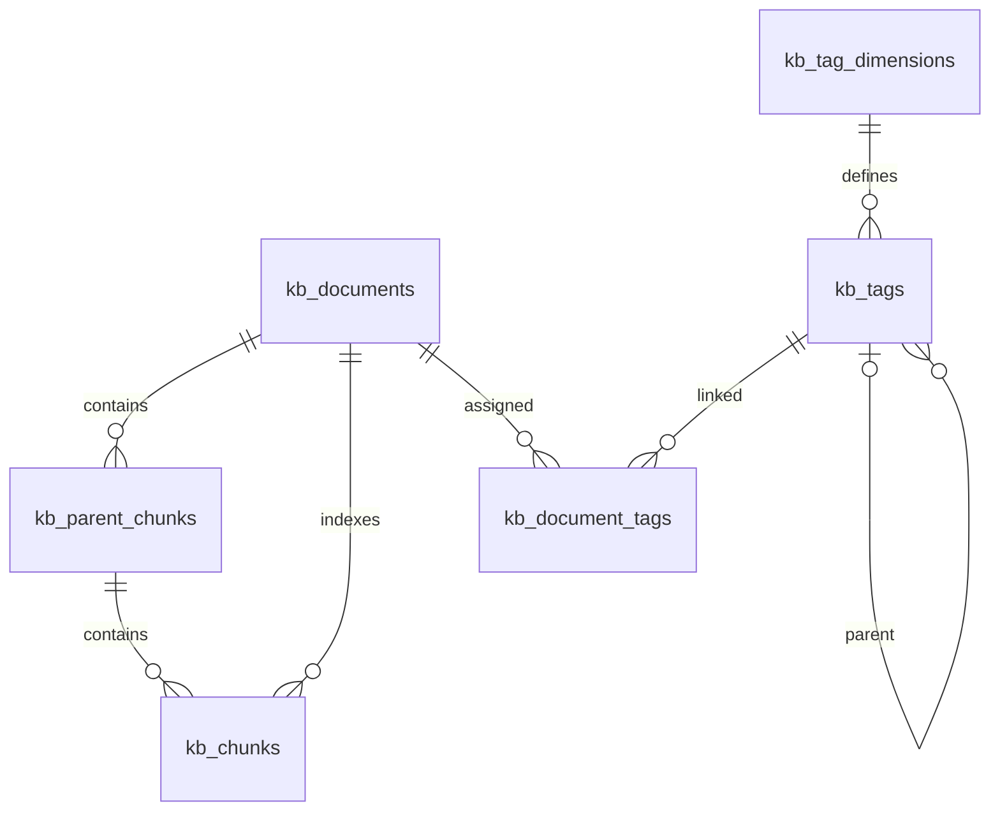

# 数据库设计与手动执行顺序

**本次未连接、读取、建表、初始化或修改实际数据库。未经用户明确同意，后续协作者也不得操作数据库，不得删除任何目录，不能执行任何 Git/SVN 操作。** 以下是供用户自行审阅执行的说明。

## 文件执行顺序

| 顺序 | 文件或命令 | 效果 |
|---|---|---|
| 1 | sql/01_schema.sql | 在 ragdb 的 public 下建扩展、6 张表及普通 / GIN / HNSW 索引 |
| 2 | sql/02_seed_documents.sql | 插入 28 条虚构企业原文、4 类标签维度、父子标签和关联；状态 pending |
| 3 | main_ingest.py（WRITE_TO_DB=True） | 生成真实 512 维向量，保存父子块，状态 ready |
| 4 | sql/03_validation_queries.sql | 用户手动执行只读数量、维度、一致性与索引检查 |
| 5 | main_ask.py 或 evaluate.py（RUN_LIVE=True） | 用户验证完整问答 |

在现有 GUI 数据库工具中选中 `ragdb`，打开 SQL 文件后执行即可，不要求使用 shell 连接。步骤 1 要求有安装 pgvector 扩展和在 public 下建表的权限。DDL 按新建表结构设计，遇到已存在的同名表会报错，不通过 IF NOT EXISTS 掩盖旧字段不兼容。若已经成功建立本版 public 下的完整新结构，请跳过步骤 1；不要自动删除后重建。

新表位于 **ragdb 数据库 → public schema**，例如 `public.kb_documents`。之前的 `rag_learning` 是 schema 名，不是数据库名；本次已按现有目录调整所有仓储、建表和初始化 SQL。旧 `public.kb_documents` 与新版表同名，需要用户按自己的备份与重建安排先处理，不能把旧结构当作新版直接初始化。旧表停用建议见 [盘点](01-inventory.md)。本次未连接数据库，也不会自动搬迁此前可能已经建立的 rag_learning 中的数据。

数据库账号密码在项目根目录 [`.env.db`](../.env.db)，连接目标已按旧 `DB_CONFIG` 填写。配置格式和优先级详见 [账号与数据库名称说明](08-db-config.md)。

## 表和字段备注

`01_schema.sql` 已为全部 6 张表、53 个字段补齐中文说明。字段定义后面的 `--` 注释方便直接阅读 SQL；文件末尾的 `COMMENT ON TABLE / COLUMN` 会把备注保存到数据库，执行后可在数据库工具的表或字段详情中查看。

- 还没有创建新版表：使用带备注的 `01_schema.sql` 建表即可。
- 已经按本项目 SQL 建好了新版表：只需用户手动执行 [04_comments.sql](../sql/04_comments.sql) 补充备注，**不需要删表重建**。
- 如果仍然是截图中的旧表结构，补备注脚本不能代替建表或结构迁移。

备注包含字段用途、常见示例、状态取值、父子表关系和字符位置计算方式。添加备注没有改变字段类型、默认值、约束、索引或业务数据，本次也没有连接或操作数据库。

## 表关系



实际是 **6 张表**：原文、父块、子块、标签维度、标签字典、文档标签关联。标签冗余字段位于原文表 `tags text[]`，不是再复制整张标签表。

| 表 | 主要字段 / 用途 |
|---|---|
| kb_documents | 原文 content、原始 payload、metadata、tenant_id、business_module、doc_type、security_level、version、is_latest、source、tags、content_hash、index_status、pipeline_fingerprint、时间戳 |
| kb_parent_chunks | 大上下文块、文档关系、parent_index、原文字符起止 |
| kb_chunks | 小检索块、父块关系、chunk_index、来源 metadata、embedding、embedding_model |
| kb_tag_dimensions | 每租户维度字典：module / region / audience / lifecycle |
| kb_tags | 标签代码、名称、dimension_code、parent_id；父标签必须同租户同维度 |
| kb_document_tags | 文档与标签多对多，assigned_by 与 confidence 预留人工 / 自动打标来源 |

## 原文与 JSON

`payload JSONB` 原样保存业务对象，适合检查订单结构、退款状态与嵌套规则。`vector_fields` 是输入 JSON 中的字段白名单，会同时记录到 metadata。默认选 `content` 和 `structured_data`；嵌套对象按字段路径展开，例如 `structured_data.住宿标准[0].每晚人民币: 600`。不要把所有内部字段无差别送入 Embedding。

`metadata` 用于 query 前过滤和来源定位，例如：

```json
{
  "entity_ids": ["A1002", "R1001"],
  "section": "退款进度",
  "snapshot_at": "2026-09-17T10:00:00+08:00",
  "vector_fields": ["content", "structured_data"]
}
```

向量是内容的数值编码，存于 `vector(512)`，无需再冗余一份 JSON 数组。初始化不写向量占位。样例使用当前默认切分参数可生成 28 个父块、30 个子块；最终以预览实际输出为准。

## 索引和约束

- 原文业务键 `(tenant_id, external_id, version)` 唯一；部分唯一索引约束每租户每文档最多一个 `is_latest=true`。
- 最新 ready 文档的租户、业务模块、文档类型和权限使用复合 B-tree 索引。
- tags 使用数组 GIN；metadata / payload 使用 `jsonb_path_ops` GIN，面向 `@>` 包含查询。payload 索引用于后续结构化查询，当前问答主要使用 metadata。
- 子块 embedding 使用 HNSW 余弦索引；文档、父块和租户 / 模型各有普通索引。切换模型，即使维度相同，也要重新生成向量，查询还会按 embedding_model 过滤。
- 跨表外键带 tenant_id，避免子块或标签关联到其他租户。父块外键还携带 document_id，防止关联到同租户另一篇文档。
- 当前不启用数据库 RLS；这是学习 CLI 的应用层过滤设计，不能当作已经部署的多用户权限系统。

HNSW 为近似检索。pgvector 0.8+ 支持迭代扫描，可由用户确认版本后在查询事务中开启 `SET LOCAL hnsw.iterative_scan = strict_order`；本项目兼容基础 HNSW，默认只设 `ef_search=100`。过滤后仍可能不足 K，需要结合真实规模调参。参考 [pgvector 官方过滤说明](https://github.com/pgvector/pgvector#filtering)。初始化较大数据集后可由用户自行执行 ANALYZE；本次没有执行维护语句。

## 多维标签与父子关系

字典示例：`module:finance` 是父标签，`module:finance-travel` 是差旅子标签；一篇文档可以同时有 `region:cn`、`audience:employee` 等标签。main_ask.py 中 `TAGS` 列表的多个标签使用 AND 关系。

当前标签过滤是精确代码匹配，查询父标签不会自动包含子标签。需要财务全部文档时用 `BUSINESS_MODULE = "finance"`；需要财务差旅时用 `TAGS = ["module:finance-travel"]`。自动打标、层级递归查询、标签编辑与循环校验不在当前代码范围；新建字典关系时须确保无环。数据库仅防止直接自指和跨维度父子关系。

规范标签关联与原文冗余 tags 在入库的同一事务维护，未知标签会报错，不自动创建随意拼写的新标签。手动修改任何一侧后要同步另一侧；`03_validation_queries.sql` 提供一致性检查。

## 28 条数据的验证目的

26 条 acme 文档版本与 2 条 beta 文档，涵盖财务、人事、IT、安全、采购、销售、客服、法务与产品。acme 差旅制度包含旧版 450 元和新版 600 元；beta 同名制度为 900 元。A1002 在两个租户金额分别为 12800 和 77000。机密预算需要级别 3。订单、退款资料是注明时间的快照，不能代表实时业务系统状态。

`02_seed_documents.sql` 由 `scripts/build_seed_sql.py` 从 JSON 生成，使用与仓储相同的 UUID 和文档指纹。以后要调整样例，先改 JSON，再手动运行脚本重生成 SQL 文本。初始化 SQL 对已存在业务键不覆盖；它不是升级或数据迁移工具。


此前按旧代码写法简化 Python 时，原三个 SQL 文件保持不变；此次根据用户要求，仅给建表脚本补充备注，并新增独立的补备注脚本，表结构仍不变。SQL 历史注释中的 ingest --write 表示真实向量入库操作，现在通过 main_ingest.py 的 WRITE_TO_DB=True 执行。
