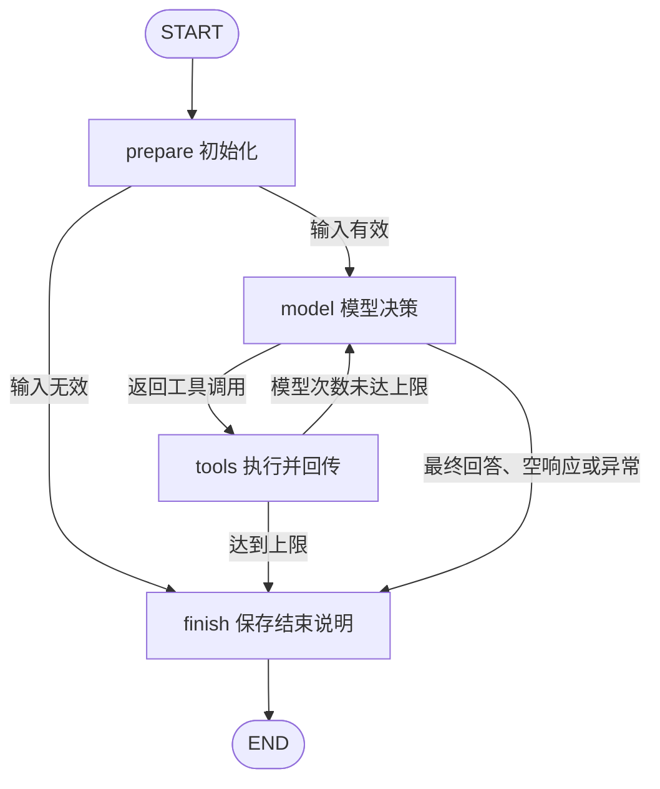

# 第 62 课：阶段 3 Tool Calling 迁移到 LangGraph Agent

> 本文件与 `agent_loop.py` 保留第 62 课对照。当前根入口已切换到 [第 69 / 70 课：Tracing 与订单诊断](19-order-diagnosis.md)，下文记录第 62 课当时的运行步骤；旧图测试仍可独立运行。

本课把阶段 3 的模型调用循环拆成 LangGraph 节点。业务 Tool 仍然使用上一课的 `get_order`、`get_payment`、`get_refund`，模型负责选择工具名和订单号，程序负责执行并回传。新 Python 代码逐行添加中文注释。

## 从旧代码迁移了什么

历史 `python_basic/toolcalling/mian_mysql.py` 中已经有 `while True`、工具说明、`tool_calls` 分发，以及 `role="tool"` 结果回传。旧文件保留为只读参考；本课复用这些概念，通过图的循环边和条件边控制执行。

| 阶段 3 写法 | 本课位置 | 职责 |
|---|---|---|
| tools 函数说明列表 | `agent_loop.py` 的 `TOOL_SCHEMAS` | 告诉模型有哪些工具及参数 |
| messages | `AgentState.messages` | 保存本次问题、每轮调用请求与工具结果 |
| client.chat.completions.create | `tool_model.py` 的 `chat_with_tools()` | 发送历史与工具说明，取回 assistant 消息 |
| while True 中调用模型 | `model_node()` | 一次节点执行调用一次模型 |
| if message.tool_calls | `choose_model_route()` | 选择执行工具或结束 |
| tool_map + JSON 参数解析 | `dispatch_tool()` | 校验名称、参数并调用普通 Python 函数 |
| messages.append(role="tool") | `tools_node()` | 追加与调用 ID 配对的结果消息 |
| 回到下一轮 while | `choose_tools_route()` 返回 model | 次数允许时继续模型决策 |
| break | `finish → END` | 正常回答、错误或达到上限时退出 |

上一课 `order_flow.py` 的下一步由业务条件固定决定。本课的下一步来自模型返回的 `tool_calls`，例如只问退款时可以直接查询 `get_refund`；完整诊断可能多轮查询，也可能一轮请求多个工具。

## 图的循环和退出



路由函数读取已合并的 State，不负责执行模型或 Tool。`run_model()`、`run_tools()` 仍是 `build_graph()` 内部的普通函数，用来绑定模型对象和 JSON 路径。

| stop_reason | 触发条件 | 最终行为 |
|---|---|---|
| final_answer | 模型没有 tool_calls，且给出非空回答 | 保存回答，正常 END |
| max_steps | 完成本轮工具执行后，模型调用次数已达到上限 | 保留全部结果，说明尚未生成完整回答，END |
| model_error | 模型请求异常、生成截断或返回协议无效 | 保留此前业务结果，说明模型失败，END |
| empty_response | 模型既无工具请求，也无回答文字 | 明确说明空响应，END |
| invalid_input | 问题为空或缺少可信租户 | 不调用模型，END |

Tool 的 `success=false` 属于可回传的执行结果，通常交给下一轮模型说明原因或修正参数。每一轮仍消耗次数，因此即使模型持续选择失败工具，也会受控结束。模型提示词要求订单不存在或未支付时及时结束；这类业务判断是模型行为要求，不是上一课那种硬编码业务路由。程序硬性执行的边界是工具白名单、参数限制、租户注入和最大模型调用次数。

## MAX_STEPS 怎么计数

入口的 `MAX_STEPS=5` 表示最多尝试调用模型五次。最终生成回答也算一次，Tool 执行不单独增加这个计数。同一轮模型返回两条 Tool 请求时，程序依次执行两条，`model_steps` 仍只增加一次。

完整诊断的一种可能顺序：第 1 次模型选择订单 → 执行订单；第 2 次选择支付 → 执行支付；第 3 次选择退款 → 执行退款；第 4 次生成回答并结束。这只是说明顺序的例子，真实模型不保证采用相同路径。

设置 `MAX_STEPS=1` 时，如果第一轮模型请求工具，程序仍执行并回传这一批结果，随后结束，不再花第二次调用生成总结。如果第一轮已直接给出回答，则正常结束为 `final_answer`。最后一轮的每条调用都有对应 tool 消息，不留下未配对请求。

LangGraph 的 `recursion_limit` 限制图的调度步数，和本课模型调用次数不同；节点顺序执行会占用不同调度步。[官方 Graph API 说明](https://docs.langchain.com/oss/python/langgraph/graph-api#recursion-limit)解释了这个区别。本课构图时设为 `2 * max_steps + 4`，给每轮 model/tools 以及 prepare/finish 留出余量；业务退出仍由 `choose_tools_route()` 控制。

本课不设整个任务的总耗时或总费用预算，沿用模型请求超时和单次输出长度配置。SDK 自动重试关闭，避免一次模型节点隐含多次请求；重试策略、总耗时与成本预算在后续课程学习。

## 为什么必须回传 tool_call_id

模型可以返回这样的 assistant 消息：

```json
{
  "role": "assistant",
  "content": "",
  "tool_calls": [{
    "id": "refund_call_1",
    "type": "function",
    "function": {"name": "get_refund", "arguments": "{\"order_id\":\"A1002\"}"}
  }]
}
```

程序先把这条 assistant 消息保存到 `messages`，执行 `get_refund` 后再追加 `role="tool"` 消息，其 `tool_call_id` 必须是 `refund_call_1`，`content` 是 `json.dumps(result, ensure_ascii=False)` 得到的完整结果字符串。下一次模型调用收到整个历史，才能根据真实结果继续判断。[DeepSeek Tool Calls 说明](https://api-docs.deepseek.com/guides/tool_calls/)也采用这种请求与结果配对方式。

本课 `messages` 是普通列表，每次节点返回更新后的完整列表；没有引入消息 reducer。`tool_results` 另存调用 ID、工具名称、参数字符串和统一业务结果，异常或达到上限时也不丢失。它们属于本次运行的上下文，不是跨次会话 Memory。

`tool_model.py` 将 SDK 响应转换为普通消息字典。部分兼容服务使用 `reasoning_content` 协议字段，需要在后续请求中保留；本课原样回传但不打印为 Console 回答。实际兼容性仍以你配置的模型支持情况为准。

## Run / Debug

打开根目录 `main_workflow.py`，解释器选 `/Users/uranuschen/ai-study/.venv/bin/python`，在可输入的 Console 直接 Run / Debug，不需要命令行参数。

```bash
.venv/bin/python -B main_workflow.py
```

这次入口会真实调用模型：默认 `USE_OLLAMA=False`，沿用现有 `LLM_BASE_URL`、`LLM_MODEL` 和密钥配置；设为 `True` 后，使用本机 `OLLAMA_MODEL` 指定的已安装模型，该模型需要支持 Tool Calling。只会实例化模型和 JSON Tool，配置加载不会创建数据库连接。

建议先输入「查询 A1002 的退款记录」，按以下位置观察：

1. `main_workflow.py` 的 `graph.invoke(initial_state)`：看 `question`、`tenant_id`、`max_steps`。
2. `agent_loop.py` 的 `model_node()`：看发出的 `messages`、返回的 `message` 及 `pending_tool_calls`。单步可进入 `tool_model.py` 的 SDK 调用。
3. `choose_model_route()`：观察本轮是去 `tools`，还是结束。
4. `tools_node()` → `dispatch_tool()`：观察工具名称、JSON 参数解析和可信租户注入，再进入上一课的业务 Tool。
5. `tools_node()` 的 `messages.append(...)`：核对原请求 `id` 和结果 `tool_call_id`，查看 `content` 中的完整 JSON。
6. `choose_tools_route()`：看 `model_steps < max_steps` 时如何回到 model。
7. 下一次 `model_node()`：确认本轮输入已经包含上轮工具结果。
8. `finish_node()`：确认退出原因及所有已经取得的结果。

试验问题：仅查询订单、仅查询退款、完整诊断订单、缺少订单号、查询不存在订单。观察实际 `tool_calls`，不要假定每个问题都查询三个工具。缺少密钥、服务不可用或模型不支持工具时，会进入 `model_error`；在模型节点 `except` 处查看 `error` 定位原因，避免打印整个配置对象。

## 离线验证与验收

```bash
PYTHONPATH=src .venv/bin/python -B -m unittest discover -s tests -p 'test_agent_loop.py' -v
```

`tests/test_agent_loop.py` 使用明确的 `ScriptedModel` 测试替身，预设下一条 assistant 消息。它只验证协议和流程，不能证明真实模型会选对工具。图、消息回传和 JSON Tool 都实际执行；测试还替换 SDK 客户端验证请求参数、序列化和入口接线，全程不读取真实配置、不访问模型或数据库。

离线 Debug 可以在 `test_full_loop_returns_each_tool_result_to_model()` 中的 `graph.invoke` 调用行打断点，然后进入相同的 model/tools 节点。用 `test_repeated_tool_requests_stop_exactly_at_limit()` 查看持续请求工具时的退出过程。

本课验收：能够说明模型输出的工具请求与 Python 实际执行的区别；能在第二轮消息里找到上一轮工具结果；能解释正常 END 与最大次数 END；能确认达到上限不会额外调用模型，并保留已有业务记录。
